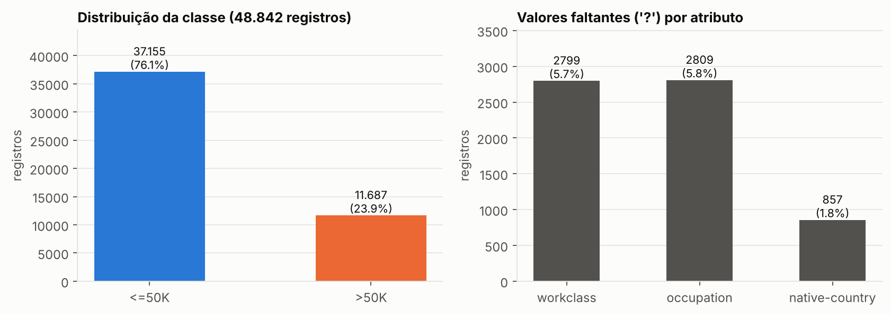
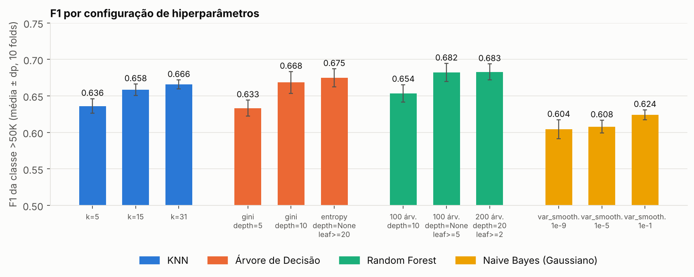
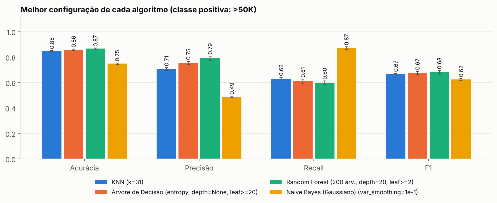
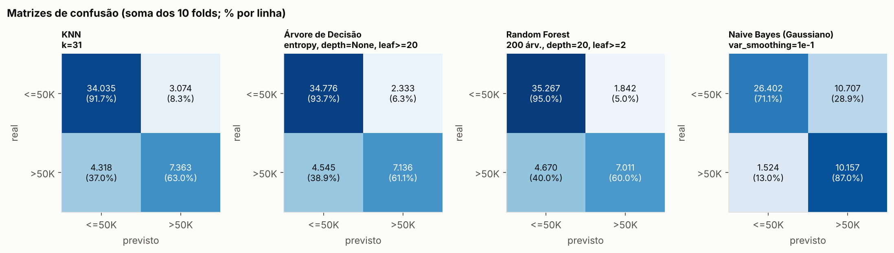
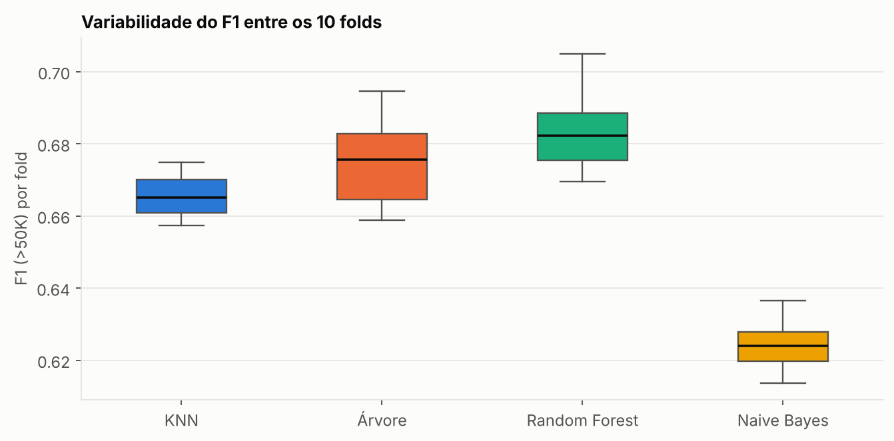
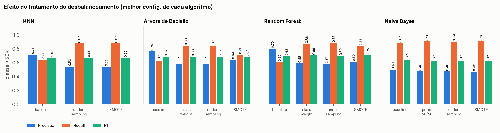

# 📊 Adult Income Classification — Benchmark & Machine Learning Study

Pipeline ponta a ponta de aprendizado de máquina para classificação de renda (`<=50K` vs `>50K`) a partir da base **UCI Adult Census Income**, com foco em rigor metodológico: ausência de vazamento de dados (*data leakage*), estudo de ablação de pré-processamento, comparação de hiperparâmetros, tratamento de desbalanceamento e validação estatística com testes de Wilcoxon.

---

## 📌 Sumário
- [Visão Geral](#-visão-geral)
- [Estrutura do Repositório](#-estrutura-do-repositório)
- [Base de Dados](#-base-de-dados)
- [Metodologia Experimental](#-metodologia-experimental)
- [Resultados e Comparações](#-resultados-e-comparações)
  - [Tabela Principal de Desempenho](#tabela-principal-de-desempenho)
  - [Testes de Hipótese (Wilcoxon)](#testes-de-hipótese-wilcoxon)
  - [Tratamento de Desbalanceamento](#tratamento-de-desbalanceamento)
- [Visualizações](#-visualizações)
- [Como Reproduzir](#-como-reproduzir)
- [Tecnologias Utilizadas](#-tecnologias-utilizadas)

---

## 🎯 Visão Geral

O objetivo deste projeto é prever se a renda anual de um indivíduo ultrapassa US$ 50.000 com base em variáveis demográficas e socioeconômicas extraídas do Censo dos EUA de 1994.

### Destaques do Projeto:
1. **Prevenção Estrita de Vazamento de Dados (*No Data Leakage*)**: Todas as etapas de imputação, padronização, codificação *one-hot*, seleção de atributos e reamostragem são executadas estritamente dentro de `imblearn.pipeline.Pipeline`, sendo reajustadas apenas com o conjunto de treino de cada fold.
2. **Validação Cruzada Robusta**: Estratificada de 10 folds (*10-Fold Stratified Cross-Validation*) com semente fixa (`SEED = 42`).
3. **Ablação Sistemática**: Avaliação do impacto isolado de tratamento de valores ausentes, remoção de colunas redundantes/ruidosas (`education`, `fnlwgt`), transformação logarítmica e seleção de atributos (`SelectKBest`).
4. **Análise de Desbalanceamento**: Comparação de estratégias como ponderação de classes (`class_weight='balanced'`), subamostragem aleatória (*RandomUnderSampler*) e sobreamostragem sintética (*SMOTE*).
5. **Comprovação Estatística**: Aplicação do teste não-paramétrico pareado de postos sinalizados de Wilcoxon para validar a superioridade estatística dos modelos.

---

## 📁 Estrutura do Repositório

```text
adult-income-classification/
├── figures/                     # Gráficos e visualizações geradas
│   ├── fig1_eda.png
│   ├── fig2_f1_configuracoes.png
│   ├── fig3_melhores_metricas.png
│   ├── fig4_matrizes_confusao.png
│   ├── fig5_boxplot_f1.png
│   └── fig6_desbalanceamento.png
├── results/                     # Resultados tabulares dos experimentos
│   ├── ablacao_log.txt
│   ├── ablacao_preproc.csv
│   ├── desbalanceamento.csv
│   ├── desbalanceamento_log.txt
│   ├── experimentos_folds.csv
│   ├── experimentos_log.txt
│   ├── experimentos_resumo.csv
│   ├── figuras_log.txt
│   ├── matrizes_confusao.json
│   ├── tabela_principal.csv
│   └── testes_wilcoxon.csv
├── 01_eda.py                    # Análise exploratória e detecção de faltantes
├── 02_ablacao_preproc.py        # Estudo de ablação das decisões de pré-processamento
├── 03_experimentos.py           # Benchmark de algoritmos (4 modelos x 3 configs)
├── 04_desbalanceamento.py       # Avaliação de técnicas para lidar com desbalanceamento
├── 05_figuras_tabelas.py        # Geração de gráficos, tabelas e testes estatísticos
├── prep.py                      # Módulo central: carregamento, pipelines e CV
├── eda_output.txt               # Log resumido da análise exploratória
├── requirements.txt             # Dependências do projeto
└── README.md                    # Documentação completa
```

---

## 💾 Base de Dados

Os dados são provenientes do **UCI Machine Learning Repository: Adult Dataset**:
- **Total de instâncias**: 48.842 (unificação de `adult.data` e `adult.test` para validação cruzada 10-fold).
- **Atributos de entrada**: 14 (6 numéricos e 8 categóricos).
- **Variável alvo**: `income` (`<=50K` [76,07%] e `>50K` [23,93%]).
- **Valores ausentes**: Identificados como `?` em `workclass` (5,7%), `occupation` (5,7%) e `native-country` (1,8%).

---

## 🔬 Metodologia Experimental

### Pipeline de Pré-processamento Selecionado
A partir das ablações da Etapa 2, definiu-se:
- **Tratamento de faltantes**: Substituição do caractere `?` pela categoria explícita `"Unknown"` (mostrou melhor preservação de sinal sem descarte de amostras).
- **Tratamento de redundâncias e ruído**:
  - Remoção de `education` (100% redundante com `education-num`).
  - Remoção de `fnlwgt` (peso amostral do Censo que adiciona ruído e prejudica generalização).
- **Variáveis numéricas**:
  - Transformação `log1p` em `capital-gain` e `capital-loss` devido à assimetria extrema (grande concentração de zeros e cauda longa).
  - Padronização (*StandardScaler*) para `age`, `education-num` e `hours-per-week`.
- **Variáveis categóricas**: *One-Hot Encoding* agrupando categorias raras.

### Algoritmos Avaliados
1. **KNN (K-Nearest Neighbors)**: `k=5`, `k=15`, `k=31`
2. **Árvore de Decisão**:
   - `gini, max_depth=5`
   - `gini, max_depth=10`
   - `entropy, max_depth=None, min_samples_leaf=20`
3. **Random Forest**:
   - `100 árvores, max_depth=10`
   - `100 árvores, max_depth=None, min_samples_leaf=5`
   - `200 árvores, max_depth=20, min_samples_leaf=2`
4. **Gaussian Naive Bayes**:
   - `var_smoothing=1e-9`, `1e-5`, `1e-1`

---

## 📈 Resultados e Comparações

### Tabela Principal de Desempenho
Métricas médias e desvio padrão obtidos na validação cruzada estratificada de 10 folds:

| Algoritmo | Configuração | Acurácia | Precisão | Revocação (Recall) | F1-Score | ROC-AUC |
| :--- | :--- | :---: | :---: | :---: | :---: | :---: |
| **Random Forest** | **200 árv., depth=20, leaf>=2** | **0.8665 ± 0.0048** | **0.7922 ± 0.0162** | 0.6002 ± 0.0119 | **0.6829 ± 0.0109** | **0.9201 ± 0.0048** |
| Random Forest | 100 árv., depth=None, leaf>=5 | 0.8651 ± 0.0056 | 0.7823 ± 0.0177 | 0.6049 ± 0.0114 | 0.6822 ± 0.0123 | 0.9192 ± 0.0049 |
| Random Forest | 100 árv., depth=10 | 0.8601 ± 0.0046 | 0.8029 ± 0.0159 | 0.5512 ± 0.0127 | 0.6536 ± 0.0119 | 0.9128 ± 0.0054 |
| Árvore de Decisão | entropy, depth=None, leaf>=20 | 0.8590 ± 0.0047 | 0.7537 ± 0.0122 | 0.6109 ± 0.0160 | 0.6747 ± 0.0123 | 0.9025 ± 0.0070 |
| Árvore de Decisão | gini, depth=10 | 0.8607 ± 0.0061 | 0.7770 ± 0.0187 | 0.5867 ± 0.0156 | 0.6685 ± 0.0149 | 0.9028 ± 0.0061 |
| Árvore de Decisão | gini, depth=5 | 0.8519 ± 0.0052 | 0.7783 ± 0.0225 | 0.5340 ± 0.0110 | 0.6333 ± 0.0110 | 0.8821 ± 0.0074 |
| KNN | k=31 | 0.8485 ± 0.0035 | 0.7057 ± 0.0120 | 0.6303 ± 0.0096 | 0.6658 ± 0.0062 | 0.9003 ± 0.0052 |
| KNN | k=15 | 0.8447 ± 0.0040 | 0.6955 ± 0.0115 | 0.6250 ± 0.0089 | 0.6583 ± 0.0079 | 0.8935 ± 0.0048 |
| KNN | k=5 | 0.8339 ± 0.0044 | 0.6687 ± 0.0110 | 0.6069 ± 0.0128 | 0.6362 ± 0.0100 | 0.8597 ± 0.0055 |
| Naive Bayes | var_smoothing=1e-1 | 0.7493 ± 0.0058 | 0.4869 ± 0.0065 | **0.8695 ± 0.0113** | 0.6242 ± 0.0068 | 0.8810 ± 0.0052 |
| Naive Bayes | var_smoothing=1e-5 | 0.7355 ± 0.0076 | 0.4712 ± 0.0084 | 0.8567 ± 0.0119 | 0.6080 ± 0.0088 | 0.8501 ± 0.0083 |
| Naive Bayes | var_smoothing=1e-9 | 0.7303 ± 0.0176 | 0.4665 ± 0.0168 | 0.8590 ± 0.0162 | 0.6043 ± 0.0130 | 0.8500 ± 0.0083 |

---

### Testes de Hipótese (Wilcoxon)
O teste não-paramétrico pareado de Wilcoxon comparou a melhor configuração de **Random Forest** contra os demais modelos nos 10 folds:

| Métrica | Comparação | Diferença Média | Folds RF Melhor | p-valor Wilcoxon | Significância (α = 0.05) |
| :--- | :--- | :---: | :---: | :---: | :---: |
| **F1-Score** | Random Forest vs KNN | +0.0171 | 10 / 10 | **0.00195** | Estatisticamente significativo |
| **F1-Score** | Random Forest vs Árvore de Decisão | +0.0081 | 8 / 10 | 0.06445 | Margem de significância |
| **F1-Score** | Random Forest vs Naive Bayes | +0.0587 | 10 / 10 | **0.00195** | Estatisticamente significativo |
| **Acurácia** | Random Forest vs KNN | +0.0180 | 10 / 10 | **0.00195** | Estatisticamente significativo |
| **Acurácia** | Random Forest vs Árvore de Decisão | +0.0075 | 10 / 10 | **0.00195** | Estatisticamente significativo |
| **Acurácia** | Random Forest vs Naive Bayes | +0.1172 | 10 / 10 | **0.00195** | Estatisticamente significativo |

---

### Tratamento de Desbalanceamento

Na classe minoritária (`>50K`, ~24%), avaliou-se o *trade-off* entre precisão e revocação ao aplicar técnicas de balanceamento:

* **Random Forest (Baseline)**: F1 = 0.6829 | Revocação = 0.6002 | Precisão = 0.7922
* **Random Forest (SMOTE)**: **F1 = 0.6981** | Revocação = 0.8286 | Precisão = 0.6032
* **Random Forest (`class_weight='balanced'`)**: **F1 = 0.6944** | Revocação = 0.8633 | Precisão = 0.5809
* **Random Forest (Subamostragem)**: F1 = 0.6886 | Revocação = 0.8760 | Precisão = 0.5673

> **Conclusão prática**: O uso de **SMOTE** ou **`class_weight='balanced'`** eleva a revocação da classe de alta renda de ~60% para **mais de 82-86%**, com ganho global de F1-Score para a classe minoritária.

---

## 📊 Visualizações

### 1. Análise Exploratória (Distribuição de Renda e Faltantes)


### 2. Comparativo de F1-Score entre as Configurações


### 3. Métricas Gerais dos Melhores Modelos


### 4. Matrizes de Confusão Acumuladas


### 5. Distribuição de F1-Score nos 10 Folds (Boxplot)


### 6. Impacto das Estratégias de Desbalanceamento


---

## 🚀 Como Reproduzir

### 1. Clone o repositório
```bash
git clone https://github.com/MayconCarpes/adult-income-classification.git
cd adult-income-classification
```

### 2. Crie e ative um ambiente virtual (recomendado)
```bash
python -m venv .venv
# No Windows:
.venv\Scripts\activate
# No Linux/macOS:
source .venv/bin/activate
```

### 3. Instale as dependências
```bash
pip install -r requirements.txt
```

### 4. Obtenha os dados do UCI Repository
Crie a pasta `data/` e baixe os arquivos [adult.data](https://archive.ics.uci.edu/static/public/2/adult.zip) e `adult.test`:
```bash
mkdir data
# Coloque 'adult.data' e 'adult.test' dentro da pasta data/
```

### 5. Execute o pipeline em sequência
```bash
python 01_eda.py              # Análise exploratória inicial
python 02_ablacao_preproc.py  # Ablações de pré-processamento
python 03_experimentos.py     # Benchmark com 10-Fold CV
python 04_desbalanceamento.py # Comparação de técnicas de balanceamento
python 05_figuras_tabelas.py  # Geração de gráficos, tabelas e testes de Wilcoxon
```

---

## 🛠 Tecnologias Utilizadas

- **Linguagem**: Python 3
- **Machine Learning & Pipeline**: [scikit-learn](https://scikit-learn.org/), [imbalanced-learn](https://imbalanced-learn.org/)
- **Manipulação de Dados**: [pandas](https://pandas.pydata.org/), [NumPy](https://numpy.org/)
- **Estatística**: [SciPy](https://scipy.org/) (testes de Wilcoxon)
- **Visualização**: [Matplotlib](https://matplotlib.org/)
- **Computação Paralela**: [joblib](https://joblib.readthedocs.io/)
