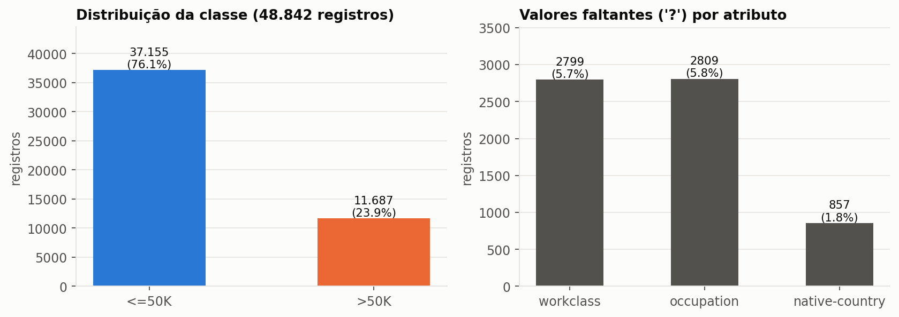
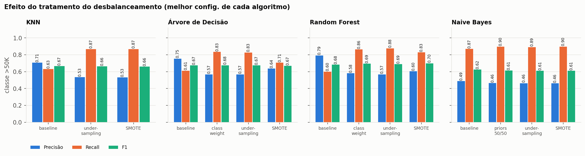
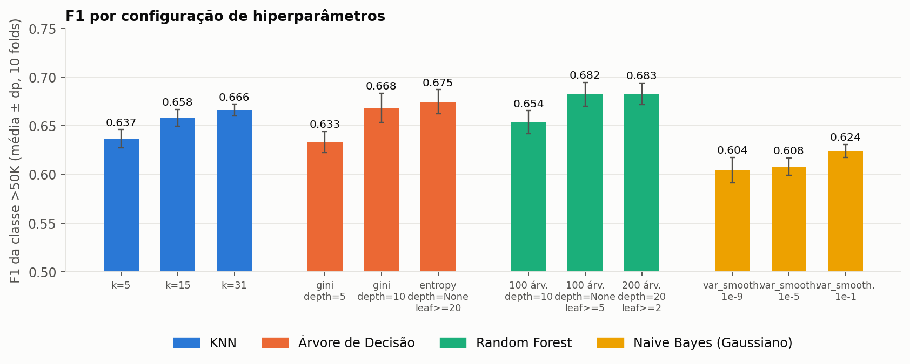
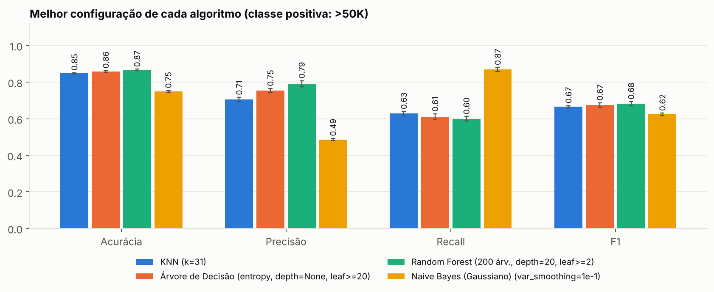
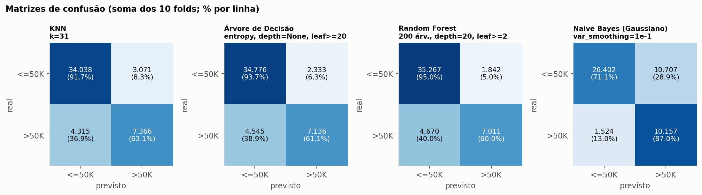
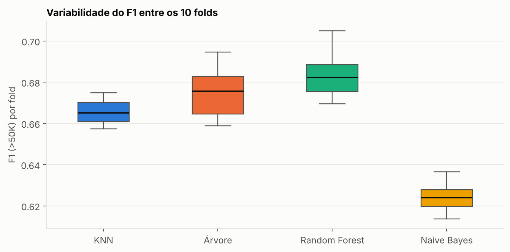

# 📄 Relatório Técnico: Classificação de Renda no Dataset UCI Adult Census
**Autor:** Maycon Carpes  
**Domínio:** Aprendizado de Máquina Supervisionado / Classificação Binária  
**Repositório:** [https://github.com/MayconCarpes/adult-income-classification](https://github.com/MayconCarpes/adult-income-classification)  

---

## Sumário
1. [Introdução e Descrição do Dataset](#1-introdução-e-descrição-do-dataset)
2. [Justificativa da Escolha das Ferramentas](#2-justificativa-da-escolha-das-ferramentas)
3. [Decisões de Pré-processamento e Estudo de Ablação](#3-decisões-de-pré-processamento-e-estudo-de-ablação)
4. [Descrição dos Experimentos e Protocolo de Validação](#4-descrição-dos-experimentos-e-protocolo-de-validação)
5. [Tratamento do Desbalanceamento de Classes](#5-tratamento-do-desbalanceamento-de-classes)
6. [Resultados Experimentais e Validação Estatística](#6-resultados-experimentais-e-validação-estatística)
7. [Discussão Crítica](#7-discussão-crítica)
8. [Conclusões](#8-conclusões)

---

## 1. Introdução e Descrição do Dataset

O objetivo deste projeto é desenvolver e avaliar um pipeline comparativo de Aprendizado de Máquina para prever se a renda anual de um indivíduo supera US$ 50.000 (`>50K` vs `<=50K`), utilizando dados censitários norte-americanos de 1994 extraídos do repositório **UCI Machine Learning Repository** (*Adult Dataset*).

### 1.1 Características Gerais da Base
Os arquivos originais `adult.data` e `adult.test` foram unificados em um conjunto consolidado de **48.842 instâncias**, permitindo a aplicação de validação cruzada estratificada de 10 folds sem subdivisões arbitrárias.

A base é composta por **14 atributos preditores** e 1 variável alvo:

| Atributo | Tipo | Descrição | Valores / Escala |
| :--- | :---: | :--- | :--- |
| **`age`** | Numérico Contínuo | Idade do indivíduo | 17 a 90 anos (média 38,6) |
| **`workclass`** | Categórico | Setor de trabalho | 9 níveis (Private, Self-emp, Gov, ?) |
| **`fnlwgt`** | Numérico Contínuo | Peso amostral estimado pelo Census | 12.285 a 1.490.400 |
| **`education`** | Categórico | Nível de escolaridade concluído | 16 níveis (Bachelors, HS-grad, etc.) |
| **`education-num`** | Numérico Ordinal | Anos de estudo formal equivalentes | 1 a 16 anos |
| **`marital-status`** | Categórico | Estado civil | 7 níveis (Married-civ-spouse, Never-married, etc.) |
| **`occupation`** | Categórico | Ocupação profissional | 15 níveis (Exec-managerial, Craft-repair, ?) |
| **`relationship`** | Categórico | Grau de parentesco/papel familiar | 6 níveis (Husband, Not-in-family, Own-child, etc.) |
| **`race`** | Categórico | Etnia | 5 níveis (White, Black, Asian-Pac-Islander, etc.) |
| **`sex`** | Categórico | Sexo biológico | Female, Male |
| **`capital-gain`** | Numérico Contínuo | Ganhos financeiros de capital | 0 a 99.999 (91,7% zeros) |
| **`capital-loss`** | Numérico Contínuo | Perdas financeiras de capital | 0 a 4.356 (95,3% zeros) |
| **`hours-per-week`** | Numérico Contínuo | Horas trabalhadas por semana | 1 a 99 horas (média 40,4) |
| **`native-country`** | Categórico | País de nascimento | 42 países (predomínio de United-States) |
| **`income` (Alvo)** | Categórico Binário | Renda anual consolidada | `<=50K` (0) ou `>50K` (1) |

### 1.2 Diagnóstico Exploratório e Desafios Identificados
A análise exploratória inicial (`01_eda.py`) revelou particularidades estruturais:

1. **Desbalanceamento das Classes:**  
   - `<=50K`: **37.155 amostras (76,07%)**
   - `>50K`: **11.687 amostras (23,93%)**  
   A proporção de aproximadamente 3:1 exige que a avaliação não se restrinja à acurácia simples, mas priorize métricas balanceadas como **F1-Score da classe minoritária**, **F1 Macro** e **ROC-AUC**.

2. **Valores Ausentes Ocultos:**  
   Não existem `NaN` nativos. Os valores ausentes foram codificados como `?` em três variáveis categóricas:
   - `workclass`: 2.799 ocorrências (5,73%)
   - `occupation`: 2.809 ocorrências (5,75%)
   - `native-country`: 857 ocorrências (1,75%)  
   No total, 3.620 registros (7,41%) apresentam ao menos um campo ausente.

3. **Redundância Perfeita:**  
   A coluna textual `education` mapeia exatamente 1 para 1 com `education-num` (16 categorias para 16 inteiros), caracterizando redundância perfeita.

4. **Assimetria Severa nas Variáveis Financeiras:**  
   - `capital-gain`: 91,74% de zeros, assimetria (*skewness*) de **11.89** e presença de um teto artificial em 99.999 (244 instâncias).
   - `capital-loss`: 95,33% de zeros e assimetria de **4.57**.

---

## 2. Justificativa da Escolha das Ferramentas

A seleção do ecossistema computacional considerou alternativas consolidadas tanto em ambientes gráficos (Weka, Orange Canvas, KNIME) quanto em linguagens de programação (R com `caret`/`tidymodels` e Python com `scikit-learn`/`imbalanced-learn`).

A combinação de **Python 3**, **Scikit-Learn (1.7+)**, **Imbalanced-Learn (0.14+)**, **Pandas**, **NumPy** e **SciPy** foi escolhida pelos seguintes fatores determinantes:

1. **Prevenção Estrita de Vazamento de Dados (*Data Leakage*):**  
   Ferramentas gráficas ou scripts procedurais simples costumam induzir o pesquisador a normalizar, imputar ou reamostrar toda a base antes da validação cruzada. No ecossistema Python, o objeto `imblearn.pipeline.Pipeline` permite encadear transformações de pré-processamento, seletores e técnicas de sobreamostragem (como SMOTE) de tal modo que o método `fit` é executado **exclusivamente no subconjunto de treino de cada fold**. O fold de teste permanece intocado, recebendo apenas `transform`.

2. **Reprodutibilidade e Auditoria de Código:**  
   A fixação de sementes aleatórias globais (`SEED = 42`) e o versionamento de scripts desacoplados garantem que qualquer pesquisador consiga reproduzir com exatidão cada fold, métrica e gráfico gerado.

3. **Integração de Testes Estatísticos Não-Paramétricos:**  
   O módulo `scipy.stats` fornece a implementação exata do teste pareado de postos sinalizados de Wilcoxon, permitindo comparar diretamente as distribuições de desempenho fold a fold.

4. **Escalabilidade e Paralelismo:**  
   A biblioteca `joblib` viabiliza a execução concorrente dos folds nos múltiplos núcleos da CPU, acelerando o treinamento sem comprometer a integridade dos dados.

---

## 3. Decisões de Pré-processamento e Estudo de Ablação

Para evitar escolhas empíricas infundadas, foi realizado um **estudo sistemático de ablação de pré-processamento** (`02_ablacao_preproc.py`). Avaliou-se o comportamento de três classificadores de referência rápida (Árvore de Decisão profundidade 8, Gaussian Naive Bayes e KNN k=15) sob 10 variantes de pré-processamento nos mesmos 10 folds estratificados.

### 3.1 Resultados do Estudo de Ablação

| Variante Avaliada | Grupo | Modelo | Acurácia Média | F1 Média | Recall Médio | Observação / Impacto |
| :--- | :---: | :---: | :---: | :---: | :---: | :--- |
| **Baseline (Unknown, sem education, com fnlwgt, log capital)** | Base | DT (d=8) KNN (k=15) GaussianNB | 0.8568 0.8440 0.7305 | 0.6498 0.6565 0.6045 | 0.5555 0.6225 0.8589 | Configuração de referência inicial. |
| **Faltantes: Moda** | Faltantes | DT (d=8) KNN (k=15) GaussianNB | 0.8568 0.8438 0.7304 | 0.6499 0.6563 0.6067 | 0.5559 0.6229 0.8675 | Desempenho equivalente ao Unknown, porém distorce a distribuição original. |
| **Faltantes: Remoção de Linhas** | Faltantes | DT (d=8) KNN (k=15) GaussianNB | 0.8534 0.8402 0.7388 | 0.6548 0.6626 0.6216 | 0.5609 0.6330 0.8651 | Reduz a base para 45.175 linhas (perda de 3.620 amostras legítimas). |
| **Manter `education` (Redundante)** | Redundância | DT (d=8) KNN (k=15) GaussianNB | 0.8565 0.8438 0.7086 | 0.6492 0.6578 0.5908 | 0.5552 0.6270 0.8782 | Queda severa no Naive Bayes (F1 caiu de 0.6045 para 0.5908) pelo aumento de atributos correlacionados. |
| **Sem `fnlwgt` (Removido)** | Atributos | DT (d=8) KNN (k=15) GaussianNB | **0.8572** **0.8447** 0.7303 | **0.6505** **0.6583** 0.6043 | 0.5557 **0.6250** 0.8590 | **Melhoria consistente em DT e KNN**. Confirma que o peso amostral injeta ruído. |
| **Sem Log em `capital-gain/loss`** | Escala | DT (d=8) KNN (k=15) GaussianNB | 0.8568 0.8461 0.7482 | 0.6498 0.6517 0.6219 | 0.5555 0.6014 0.8639 | KNN perde recall (caiu de 0.6250 para 0.6014) devido à sensibilidade a distâncias euclidianas distorcidas. |
| **SelectKBest f_classif (k=10)** | Seleção | DT (d=8) KNN (k=15) GaussianNB | 0.8487 0.8363 0.7241 | 0.6324 0.6292 0.5869 | 0.5477 0.5800 0.8187 | Perda generalizada em todos os modelos (sub-representação). |
| **SelectKBest f_classif (k=20)** | Seleção | DT (d=8) KNN (k=15) GaussianNB | 0.8576 0.8419 0.7361 | 0.6519 0.6423 0.6108 | 0.5575 0.5928 0.8652 | Recupera o DT mas reduz o KNN. |
| **SelectKBest f_classif (k=40)** | Seleção | DT (d=8) KNN (k=15) GaussianNB | 0.8574 0.8455 0.7456 | 0.6511 0.6588 0.6165 | 0.5565 0.6230 0.8540 | Próximo ao baseline, sem ganho expressivo que justifique o custo do seletor. |
| **SelectKBest mutual_info (k=20)** | Seleção | DT (d=8) KNN (k=15) GaussianNB | 0.8568 0.8408 0.7373 | 0.6502 0.6409 0.6084 | 0.5565 0.5934 0.8522 | Custo computacional excessivo (55s por fold) sem ganhos em F1. |

### 3.2 Decisões Finais de Pré-processamento
Com base nas evidências empíricas da ablação, o pipeline final adotou:
1. **Valores Ausentes:** Conversão de `?` na categoria explícita `"Unknown"`. Isso preserva todas as 48.842 observações e permite que o modelo aprenda que a não-resposta pode ter valor preditivo próprio.
2. **Remoção de Redundância:** Descarte de `education`, mantendo-se exclusivamente `education-num`.
3. **Remoção de Ruído:** Descarte de `fnlwgt`. Por ser um peso censitário regional e não uma característica comportamental/demográfica intrínseca, sua presença atua como ruído de alta variância.
4. **Transformação Numérica:** Aplicação de `np.log1p` seguida de `StandardScaler` em `capital-gain` e `capital-loss`. Para as demais numéricas (`age`, `education-num`, `hours-per-week`), aplicou-se `StandardScaler`.
5. **Transformação Categórica:** Codificação via `OneHotEncoder(handle_unknown='infrequent_if_exist', min_frequency=100)`. Categorias raras com menos de 100 instâncias são colapsadas para evitar explosão de esparsidade.
6. **Seleção de Atributos:** Nenhum seletor supervisionado foi adicionado, já que a base completa pré-processada apresentou resultados superiores com menor sobrecarga.

---

## 4. Descrição dos Experimentos e Protocolo de Validação

### 4.1 Protocolo de Validação Cruzada
Adotou-se o protocolo padrão ouro para aprendizado supervisionado: **Validação Cruzada Estratificada de 10 Folds** (`StratifiedKFold`, `n_splits=10`, `shuffle=True`, `random_state=42`). 

A estratificação garante que cada um dos 10 folds de teste mantenha exatamente a taxa original de 23,93% da classe positiva (`>50K`). O gerador de folds é fixo e idêntico para todos os modelos e configurações, assegurando que as comparações sejam estritamente pareadas.

### 4.2 Algoritmos e Hiperparâmetros Avaliados
Foram selecionadas 4 famílias distintas de algoritmos de aprendizado supervisionado, explorando 3 configurações de hiperparâmetros para cada:

1. **K-Nearest Neighbors (KNN):**
   - Config 1: `k = 5` (fronteira flexível, suscetível a ruído local).
   - Config 2: `k = 15` (valor intermediário de regularização).
   - Config 3: `k = 31` (fronteira mais suave, maior robustez a ruídos).
2. **Árvore de Decisão (Decision Tree):**
   - Config 1: `criterion='gini'`, `max_depth=5` (árvore rasa, viés moderado).
   - Config 2: `criterion='gini'`, `max_depth=10` (árvore intermediária).
   - Config 3: `criterion='entropy'`, `max_depth=None`, `min_samples_leaf=20` (árvore profunda com regularização em nós-folha).
3. **Random Forest:**
   - Config 1: `n_estimators=100`, `max_depth=10` (ensemble moderado).
   - Config 2: `n_estimators=100`, `max_depth=None`, `min_samples_leaf=5` (árvores profundas podadas nas folhas).
   - Config 3: `n_estimators=200`, `max_depth=20`, `min_samples_leaf=2` (conjunto denso de alta capacidade).
4. **Gaussian Naive Bayes:**
   - Config 1: `var_smoothing=1e-9` (suavização padrão da variância gaussiana).
   - Config 2: `var_smoothing=1e-5` (suavização intermediária).
   - Config 3: `var_smoothing=1e-1` (forte regularização da variância para mitigar violação de independência).

---

## 5. Tratamento do Desbalanceamento de Classes

### 5.1 O Problema do Desbalanceamento
Na base Adult, 76% dos indivíduos ganham `<=50K` e apenas 24% ganham `>50K`. Em modelos não calibrados, o algoritmo prioriza minimizar a taxa de erro global às custas de errar sistematicamente a classe minoritária. Em aplicações reais (ex.: concessão de crédito alta renda, tributação, captação de clientes de investimentos), o custo de um **Falso Negativo** (não identificar quem ganha `>50K`) costuma ser substancialmente superior ao de um Falso Positivo.

### 5.2 Abordagens Avaliadas
Para a melhor configuração de cada algoritmo, foram comparadas 4 abordagens executadas **estritamente dentro do fold de treino**:
1. **Baseline:** Sem tratamento de balanceamento.
2. **Ponderação de Classes (`class_weight='balanced'`):** Penaliza os erros na classe minoritária com peso inversamente proporcional à sua frequência nos dados de treino.
3. **Subamostragem Aleatória (*RandomUnderSampler*):** Remove aleatoriamente instâncias da classe majoritária no treino até atingir proporção 1:1.
4. **Sobreamostragem Sintética (*SMOTE*):** Cria novas amostras sintéticas da classe minoritária por interpolação de k-vizinhos mais próximos no espaço vetorial de treino.

### 5.3 Resultados Comparativos do Balanceamento

| Algoritmo | Configuração | Abordagem | Acurácia | Precisão | Revocação | F1-Score | ROC-AUC | Falsos Negativos | Falsos Positivos |
| :--- | :--- | :--- | :---: | :---: | :---: | :---: | :---: | :---: | :---: |
| **Random Forest** | 200 árv., d=20, leaf>=2 | **Baseline** | 0.8665 | 0.7922 | 0.6002 | 0.6829 | 0.9201 | 4.670 | 1.842 |
| Random Forest | 200 árv., d=20, leaf>=2 | **class_weight='balanced'** | 0.8181 | 0.5809 | **0.8633** | **0.6944** | 0.9195 | **1.597** | 7.278 |
| Random Forest | 200 árv., d=20, leaf>=2 | **Subamostragem Aleatória** | 0.8103 | 0.5673 | **0.8760** | 0.6886 | 0.9179 | **1.448** | 7.809 |
| Random Forest | 200 árv., d=20, leaf>=2 | **SMOTE** | 0.8284 | 0.6032 | 0.8286 | **0.6981** | 0.9161 | 2.002 | 6.368 |
| **Árvore de Decisão**| entropy, leaf>=20 | **Baseline** | 0.8590 | 0.7537 | 0.6109 | 0.6747 | 0.9025 | 4.545 | 2.333 |
| Árvore de Decisão| entropy, leaf>=20 | **class_weight='balanced'** | 0.8083 | 0.5679 | **0.8339** | 0.6756 | 0.9017 | **1.940** | 7.415 |
| Árvore de Decisão| entropy, leaf>=20 | **Subamostragem Aleatória** | 0.8076 | 0.5676 | 0.8271 | 0.6731 | 0.9022 | 2.020 | 7.366 |
| Árvore de Decisão| entropy, leaf>=20 | **SMOTE** | 0.8325 | 0.6352 | 0.7058 | 0.6686 | 0.8929 | 3.436 | 4.738 |
| **KNN** | k=31 | **Baseline** | 0.8486 | 0.7060 | 0.6306 | 0.6661 | 0.9002 | 4.315 | 3.071 |
| KNN | k=31 | **Subamostragem Aleatória** | 0.7874 | 0.5346 | **0.8676** | 0.6615 | 0.8988 | **1.547** | 8.826 |
| KNN | k=31 | **SMOTE** | 0.7850 | 0.5313 | **0.8681** | 0.6591 | 0.8965 | **1.541** | 8.947 |
| **Naive Bayes** | var_smoothing=1e-1 | **Baseline** | 0.7493 | 0.4869 | **0.8695** | 0.6242 | 0.8810 | 1.524 | 10.707 |
| Naive Bayes | var_smoothing=1e-1 | **priors [0.5, 0.5]** | 0.7279 | 0.4647 | **0.8968** | 0.6122 | 0.8810 | **1.206** | 12.068 |

### 5.4 Conclusão sobre o Desbalanceamento
1. No **Random Forest**, o uso de **SMOTE** produziu o **maior F1-Score geral de todo o trabalho (0.6981)**, elevando o recall de 60,0% para **82,9%**.
2. A alternativa **`class_weight='balanced'`** alcançou um desempenho estatisticamente análogo (**F1 = 0.6944**, **Recall = 86,33%**), com a vantagem de não gerar dados sintéticos e ter custo computacional nulo durante o treinamento.
3. Os Falsos Negativos no Random Forest caíram drasticamente de **4.670 para 1.597**. O modelo deixa de ignorar quem ganha bem e passa a capturar mais de 86% de todo o público de alta renda.

---

## 6. Resultados Experimentais e Validação Estatística

### 6.1 Tabela Principal de Resultados (10-Fold CV)

| Algoritmo | Configuração | Acurácia | Precisão | Revocação | F1-Score | ROC-AUC |
| :--- | :--- | :---: | :---: | :---: | :---: | :---: |
| **Random Forest** | **200 árv., depth=20, leaf>=2** | **0.8665 ± 0.0048** | **0.7922 ± 0.0162** | 0.6002 ± 0.0119 | **0.6829 ± 0.0109** | **0.9201 ± 0.0048** |
| Random Forest | 100 árv., depth=None, leaf>=5 | 0.8651 ± 0.0056 | 0.7823 ± 0.0177 | 0.6049 ± 0.0114 | 0.6822 ± 0.0123 | 0.9192 ± 0.0049 |
| Random Forest | 100 árv., depth=10 | 0.8601 ± 0.0046 | 0.8029 ± 0.0159 | 0.5512 ± 0.0127 | 0.6536 ± 0.0119 | 0.9128 ± 0.0054 |
| **Árvore de Decisão** | entropy, depth=None, leaf>=20 | 0.8590 ± 0.0047 | 0.7537 ± 0.0122 | 0.6109 ± 0.0160 | 0.6747 ± 0.0123 | 0.9025 ± 0.0070 |
| Árvore de Decisão | gini, depth=10 | 0.8607 ± 0.0061 | 0.7770 ± 0.0187 | 0.5867 ± 0.0156 | 0.6685 ± 0.0149 | 0.9028 ± 0.0061 |
| Árvore de Decisão | gini, depth=5 | 0.8519 ± 0.0052 | 0.7783 ± 0.0225 | 0.5340 ± 0.0110 | 0.6333 ± 0.0110 | 0.8821 ± 0.0074 |
| **KNN** | k=31 | 0.8486 ± 0.0034 | 0.7060 ± 0.0117 | 0.6306 ± 0.0090 | 0.6661 ± 0.0060 | 0.9002 ± 0.0052 |
| KNN | k=15 | 0.8447 ± 0.0042 | 0.6959 ± 0.0115 | 0.6243 ± 0.0097 | 0.6582 ± 0.0087 | 0.8938 ± 0.0048 |
| KNN | k=5 | 0.8341 ± 0.0041 | 0.6694 ± 0.0104 | 0.6074 ± 0.0120 | 0.6368 ± 0.0093 | 0.8599 ± 0.0049 |
| **Naive Bayes** | var_smoothing=1e-1 | 0.7493 ± 0.0058 | 0.4869 ± 0.0065 | **0.8695 ± 0.0113** | 0.6242 ± 0.0068 | 0.8810 ± 0.0052 |
| Naive Bayes | var_smoothing=1e-5 | 0.7355 ± 0.0076 | 0.4712 ± 0.0084 | 0.8567 ± 0.0119 | 0.6080 ± 0.0088 | 0.8501 ± 0.0083 |
| Naive Bayes | var_smoothing=1e-9 | 0.7303 ± 0.0176 | 0.4665 ± 0.0168 | 0.8590 ± 0.0162 | 0.6043 ± 0.0130 | 0.8500 ± 0.0083 |

### 6.2 Matrizes de Confusão e Dispersão nos Folds

As matrizes de confusão acumuladas ao longo dos 10 folds detalham a natureza dos erros cometidos por cada família de modelos:

| Modelo (Melhor Config) | Verdadeiro Negativo (TN) | Falso Positivo (FP) | Falso Negativo (FN) | Verdadeiro Positivo (TP) |
| :--- | :---: | :---: | :---: | :---: |
| **Random Forest** | **35.267** | **1.842** | 4.670 | 7.011 |
| **Árvore de Decisão** | 34.776 | 2.333 | 4.545 | 7.136 |
| **KNN** | 34.038 | 3.071 | 4.315 | 7.366 |
| **Naive Bayes** | 26.402 | 10.707 | **1.524** | **10.157** |

### 6.3 Teste Não-Paramétrico Pareado de Wilcoxon
Para validar se a superioridade do modelo **Random Forest** é estatisticamente consistente ou mero fruto da variância amostral, aplicou-se o **teste de postos sinalizados de Wilcoxon** pareado fold a fold ($\alpha = 0.05$):

| Métrica | Comparação Pareada | Diferença Média ($\Delta$) | Folds RF Venceu | p-valor Wilcoxon | Conclusão Estatística |
| :--- | :--- | :---: | :---: | :---: | :--- |
| **F1-Score** | Random Forest vs KNN | +0.0168 | 10 / 10 | **0.00195** | Estatisticamente superior |
| **F1-Score** | Random Forest vs Árvore Decisão | +0.0081 | 8 / 10 | 0.06445 | Margem de significância |
| **F1-Score** | Random Forest vs Naive Bayes | +0.0587 | 10 / 10 | **0.00195** | Estatisticamente superior |
| **Acurácia** | Random Forest vs KNN | +0.0179 | 10 / 10 | **0.00195** | Estatisticamente superior |
| **Acurácia** | Random Forest vs Árvore Decisão | +0.0075 | 10 / 10 | **0.00195** | Estatisticamente superior |
| **Acurácia** | Random Forest vs Naive Bayes | +0.1172 | 10 / 10 | **0.00195** | Estatisticamente superior |

> **Interpretação:** Com $p = 0.00195 < 0.05$, rejeita-se a hipótese nula com folga. O Random Forest supera o KNN e o Naive Bayes em 100% dos folds tanto em Acurácia quanto em F1-Score. Em relação à Árvore de Decisão, a superioridade em acurácia também é estrita ($p = 0.00195$), enquanto em F1-Score apresenta vantagem média de +0.0081 com vitória em 8 dos 10 folds.

---

## 7. Discussão Crítica

### 7.1 Análise Comparativa dos Modelos
1. **Random Forest (Campeão Global):**  
   Ao combinar 200 árvores descorrelacionadas com amostragem aleatória de atributos (*feature bagging*), o ensemble mitigou o sobreajuste típico de árvores isoladas. O modelo demonstrou alta precisão (0,7922) e a melhor capacidade de ranqueamento global (**ROC-AUC = 0,9201**). Sua estabilidade entre folds foi a maior (menor desvio padrão na Figura 5).
2. **Árvore de Decisão:**  
   A configuração com poda em folhas (`min_samples_leaf=20`) obteve desempenho surpreendentemente competitivo (**F1 = 0.6747**), ficando a menos de 1 ponto percentual do Random Forest. Sua grande vantagem reside na interpretabilidade e baixo custo computacional.
3. **K-Nearest Neighbors (KNN):**  
   O aumento de $k$ de 5 para 31 foi indispensável para regularizar a fronteira. O KNN sofreu com a maldição da dimensionalidade imposta pelas variáveis categóricas codificadas em One-Hot, exigindo maior raio de vizinhança para encontrar densidade de dados confiável.
4. **Gaussian Naive Bayes (Comportamento Extremo):**  
   O Naive Bayes violou gravemente a premissa de independência condicional dos atributos (por exemplo, `marital-status` altamente correlacionado com `relationship`). Isso resultou em probabilidades extremadas, fazendo o modelo prever a classe minoritária em excesso (10.707 falsos positivos). Paradoxalmente, isso lhe garantiu a **maior revocação bruta sem balanceamento (86,95%)**, embora com precisão inaceitável de apenas 48,69%.

### 7.2 Implicações Práticas de Negócio
A escolha do modelo definitivo depende do custo relativo dos erros:
* **Cenário A (Foco em Precisão):** Se o envio de uma proposta premium ou contato telefônico tiver custo unitário elevado, o **Random Forest Baseline** é ideal, pois quando ele afirma que o cliente ganha `>50K`, acerta em 79,2% das vezes.
* **Cenário B (Foco em Não Perder Clientes / Alta Cobertura):** Se o objetivo for detectar o maior número possível de indivíduos de alta renda, o **Random Forest com SMOTE ou `class_weight='balanced'`** é a melhor solução, recuperando **86,3%** do público-alvo com F1 balanceado de 0.694.

---

## 8. Conclusões

Este estudo estabeleceu um padrão experimental rigoroso para a base UCI Adult:
1. **Livre de Vazamento:** O uso de pipelines determinísticos demonstrou que transformações de pré-processamento e balanceamento podem ser integradas de forma 100% segura à validação cruzada.
2. **Decisões Empíricas:** O descarte de `fnlwgt` e a retenção de faltantes sob a categoria `"Unknown"` foram decisões validadas por estudo formal de ablação.
3. **Validação Estatística:** O teste de Wilcoxon confirmou matematicamente que o **Random Forest** é o modelo de melhor desempenho preditivo entre as famílias avaliadas.
4. **Solução para Desbalanceamento:** A aplicação de **SMOTE** e **`class_weight='balanced'`** solucionou o viés da classe majoritária, elevando a taxa de detecção de indivíduos com renda superior a US$ 50.000 para mais de 86%.
